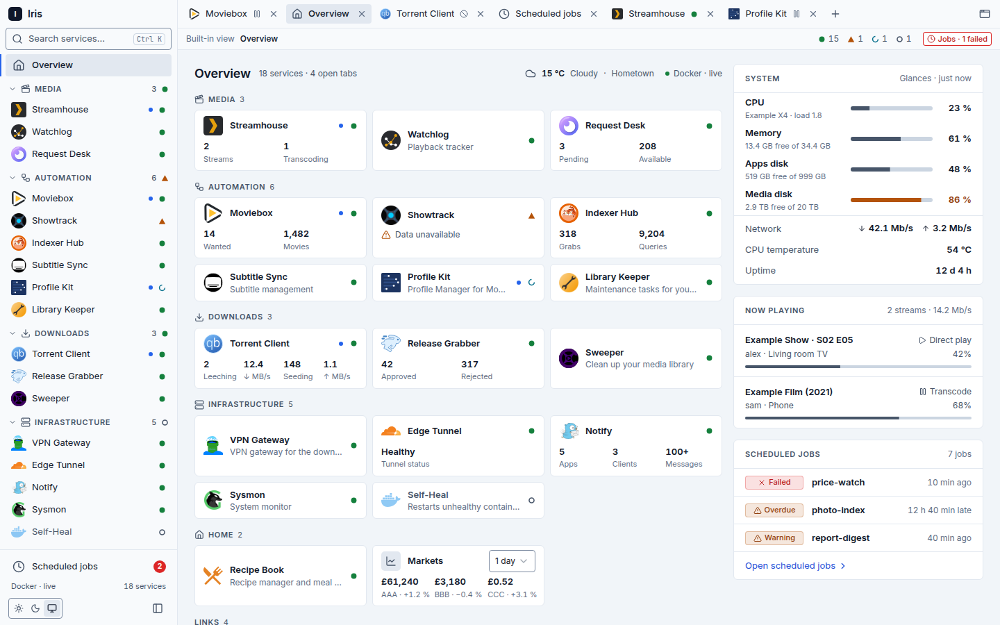

# Iris

Iris is a self-hosted dashboard for a Docker media server. It finds services from container labels, shows their health, opens them in tabs inside one page, and shows the whole stack as one dark reading around a glowing crystal ball. It is a Next.js app that runs as one container.



- **Discovery from labels.** A container with `iris.enable=true` appears with its name, group, icon and address. A YAML file covers services that cannot carry labels.
- **Health.** Docker state plus an HTTP probe give one status per service.
- **Tabs.** Services open in iframes when they allow it, and in a new browser tab when they do not. When an app sends its frame to a sign-in page (for example Cloudflare Access), Iris opens the sign-in in a small window, closes it once the app answers and shows the app in its tab. Keyboard palette, phone layout, a dark look.
- **The reading.** The Overview is one single-screen reading of the stack around a WebGL crystal ball that reacts to host load and failed jobs (with a static fallback where WebGL is missing). It has three parts: The circle (a chip for every service, with its health), The hours (scheduled jobs, from cron-status and a host status file, as a timeline) and Omens (markets, host load from Glances, and the sky), plus a footer. Now playing is no longer shown; `/api/streams` stays.
- **Integrations.** Small stat tiles for Seerr, Tautulli, Radarr, Sonarr, Prowlarr, autobrr, Gotify, qBittorrent, a Cloudflare tunnel, CoinMarketCap markets and Open-Meteo weather.

The contract (labels, config files, environment variables, endpoints) is in [docs/contract.md](docs/contract.md).

## Running it with Compose

Iris reads the Docker container list through a read-only socket proxy, so it never mounts the Docker socket. All names, hosts and paths below are placeholders.

```yaml
networks:
  iris-socket:
    internal: true

services:
  iris-socket-proxy:
    image: wollomatic/socket-proxy:1
    container_name: iris-socket-proxy
    restart: unless-stopped
    user: '65534:<docker-gid>' # nobody : the host's docker group id
    read_only: true
    cap_drop: [ALL]
    security_opt: ['no-new-privileges:true']
    mem_limit: 64M
    command:
      - -loglevel=INFO
      - -logjson
      - -listenip=0.0.0.0
      - -proxyport=2375
      - -allowfrom=iris
      - -allowGET=/v1\.[0-9]+/containers/json
      - -allowhealthcheck
      - -watchdoginterval=300
      - -stoponwatchdog
      - -shutdowngracetime=5
    volumes:
      - /var/run/docker.sock:/var/run/docker.sock:ro
    networks: [iris-socket]
    healthcheck:
      test: ['CMD', './healthcheck']
      interval: 10s
      timeout: 5s
      retries: 2

  iris:
    image: ghcr.io/leneti/iris:latest
    container_name: iris
    restart: unless-stopped
    init: true
    user: '<uid>:<gid>'
    read_only: true
    tmpfs: [/tmp, /app/.next/cache]
    cap_drop: [ALL]
    security_opt: ['no-new-privileges:true']
    depends_on:
      iris-socket-proxy:
        condition: service_healthy
    networks: [mediastack, iris-socket] # mediastack: the network your other services and Traefik share
    ports:
      - '4747:3000'
    volumes:
      - /path/to/iris/config:/config:ro
      - /path/to/iris/cache:/cache
      - /var/lib/media-status:/host-status:ro # optional: the host status file
    environment:
      - TZ=Europe/London
      - NODE_ENV=production
      - NEXT_TELEMETRY_DISABLED=1
      - HOSTNAME=0.0.0.0
      - PORT=3000
      - IRIS_DOCKER_URL=http://iris-socket-proxy:2375
      - IRIS_DOCKER_API_VERSION=1.52
      - IRIS_TRAEFIK_URL=http://traefik:80
      - IRIS_CRON_STATUS_URL=http://cron-status:9876/cron-status
      - IRIS_ZONE=example.invalid
      - IRIS_ALLOWED_HOSTS=192.0.2.10:4747,dash.example.invalid
      - IRIS_HOST_STATUS_FILE=/host-status/status.json
      - IRIS_ICONS_BASE=https://cdn.jsdelivr.net/gh/homarr-labs/dashboard-icons@f1d048d9885b97a7319e0a51e508217459f212df
      # Integration credentials; an empty value turns that integration off.
      - IRIS_RADARR_KEY=${RADARR_KEY:-}
      - IRIS_SONARR_KEY=${SONARR_KEY:-}
    healthcheck:
      test:
        [
          'CMD',
          'node',
          '-e',
          "fetch('http://127.0.0.1:3000/api/healthz').then(r=>process.exit(r.ok?0:1)).catch(()=>process.exit(1))",
        ]
      interval: 30s
      timeout: 5s
      retries: 3
      start_period: 20s
    labels:
      iris.enable: 'false'
```

Put `iris.yaml` (and optionally `services.yaml`) in the config folder, starting from [examples/](examples/). Label a service like this:

```yaml
labels:
  iris.enable: 'true'
  iris.name: Radarr
  iris.group: Automation
  iris.widget: radarr
```

To serve Iris on a DNS name, add Traefik router labels to the `iris` service as for any other app, and add that host name to `IRIS_ALLOWED_HOSTS`.

## Configuration

> **`IRIS_ALLOWED_HOSTS` is required.** It is a comma-separated list of `host[:port]` values, for example `192.0.2.10:4747,dash.example.invalid`. When it is unset or empty, **every request is answered with 400**. Only an exact match of the request's Host header passes (case and a trailing dot are normalised; a different port does not match). This is a guard against DNS rebinding, so list every address you use to open Iris.

Everything else is optional. The full list of environment variables, labels and config keys is in [docs/contract.md](docs/contract.md). Highlights:

| Variable                                        | Purpose                                  |
| ----------------------------------------------- | ---------------------------------------- |
| `IRIS_ZONE`                                     | Fills `{zone}` in config URLs            |
| `IRIS_DOCKER_URL`                               | Read-only Docker API (socket proxy)      |
| `IRIS_TRAEFIK_URL`                              | Health probes and integration requests   |
| `IRIS_CRON_STATUS_URL`, `IRIS_HOST_STATUS_FILE` | Scheduled jobs panel                     |
| `IRIS_ICONS_BASE`                               | dashboard-icons set, pinned to a commit  |
| `IRIS_FRAME_SOURCES`                            | Extra https addresses Iris may frame     |
| `IRIS_CONFIG_DIR`, `IRIS_CACHE_DIR`             | Default `/config` and `/cache`           |
| `IRIS_*_KEY`, `*_TOKEN`, qBittorrent sign-in    | Integration credentials; empty means off |

The host status file is produced by `host/media-status-export.ts`, a dependency-free Node script run by a systemd user timer (unit templates in `host/`).

## Development

Node 24 (see `.nvmrc`) and Yarn 4 through Corepack. `scripts/dev.sh` selects the Node version and keeps caches and temp files inside `.tmp/`; run every Node command through it.

```sh
scripts/dev.sh yarn install
scripts/dev.sh yarn dev:fixtures   # fixture upstreams and fake framed apps, Next on http://localhost:3000
scripts/dev.sh yarn test
scripts/dev.sh yarn verify         # lint, format check, typecheck, tests, build
```

`dev:fixtures` starts mock upstreams on 127.0.0.1:47480-47484, fake framed apps on 47485-47499 and loads `dev/.env.fixtures` (allowed hosts `127.0.0.1:3000,localhost:3000`, zone `example.invalid`). Everything in it is invented.

`IRIS_FIXTURE_SCENARIO=down|failed|strained|alt|outage scripts/dev.sh yarn dev:fixtures` shows one state for visual checks (default `normal`).

`IRIS_FIXTURE_PORT_BASE=47600` starts the five upstreams on 47600-47604 without app frames (point the `IRIS_*_URL` variables and the `iris.yaml` URLs there) and `IRIS_FIXTURE_DELAY_MS=800` holds every upstream reply back, to test a slow host beside a running `dev:fixtures`.

`scripts/dev.sh yarn cls [url]` measures Cumulative Layout Shift of a running Iris (default `http://localhost:3100/`) at 1440x900 and at a 390x844 phone, and prints the top shifting nodes. Run it against a production build (`yarn build`, then `next start -p 3100`). It exits 1 above `IRIS_CLS_MAX` (default 0.05). It uses a Chromium already in the Playwright cache, or the binary in `IRIS_CLS_CHROMIUM`; it never downloads one.

## Updates

- **Renovate** keeps dependencies, GitHub Actions (pinned by commit SHA) and the Node base image (pinned by digest) current. Nothing newer than 14 days is proposed. Non-major updates are grouped into one weekly pull request and merged automatically when checks pass; major updates are one pull request each and reviewed by hand.
- **CI** (GitHub Actions) runs install with the immutable lockfile, oxlint, oxfmt check, `tsc --noEmit`, the tests and `next build`, plus a Docker build.
- **GHCR.** Every push to `main` that passes CI publishes `ghcr.io/leneti/iris` for `linux/amd64`, tagged `latest` and `sha-<short commit>`, with provenance. A release tag `vX.Y.Z` adds a matching tag.
- **Nightly pulls.** Deployments follow `latest`: an updater on the host pulls the image each night and recreates the container. To pin a build, set `image: ghcr.io/leneti/iris:sha-<commit>`.

## Licence

MIT, see [LICENSE](LICENSE).
